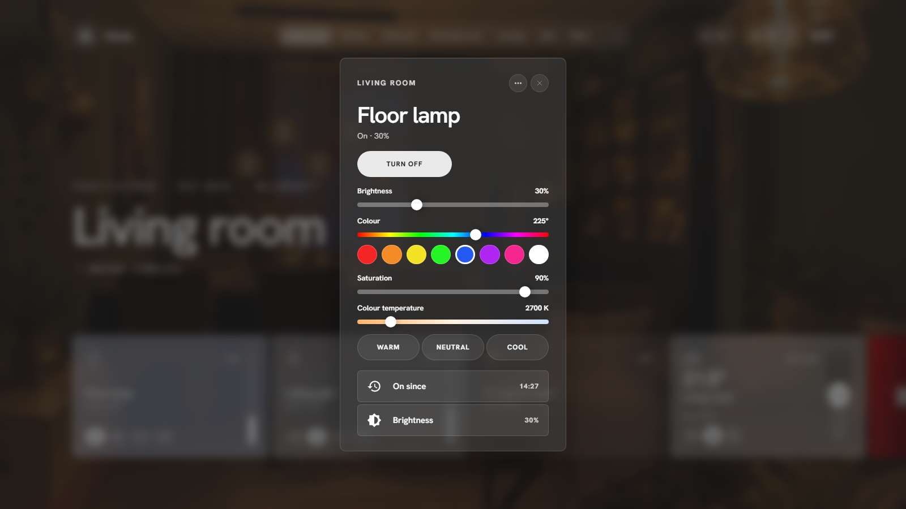
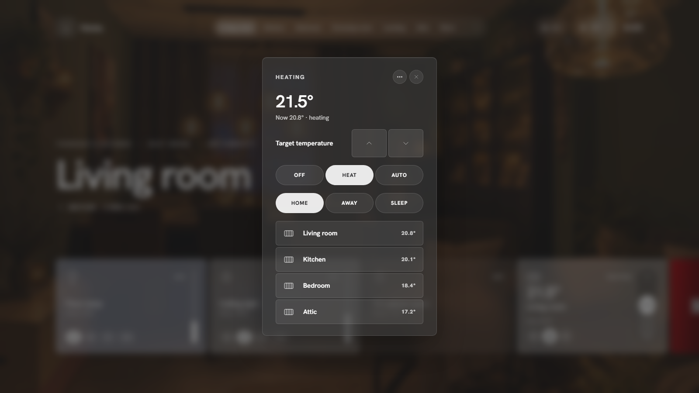

# Popups and extras

## Popups

Every card opens a popup with the details: brightness, colour and colour temperature for lights, transport and volume for media, modes and presets for climate, position for covers, and the history of the last 24 hours for sensors.

The **⋯** button next to close opens a small menu over the popup (a sheet at the bottom on phones): **Card settings** (see [Card settings](card-settings.md)), **Open in Home Assistant** (Home Assistant's own dialog for the entity), **Open device** when the entity belongs to a device, and **Hide on this page** (bring it back under *Page settings*). Esc or a tap outside closes just the menu.

A few popups do more than show details:

- **Agenda**: a week grid with a colour per calendar, an all-day row, a now-line and a side column with what is on now, what is next and the calendars to hide; *Day* and *List* (a list per day, the default on phones) sit next to *Week*. Tap an event for its time, location and description.
- **Lights** (the lights pill): every lamp that is on, per room, with a brightness slider on its row, an off per room, *All off*, and a hint when a lamp has been on for a while in a room where nothing moved. *Hide sliders* makes it a plain list again.
- **Weather**: rain for the next two hours (Buienradar's minute forecast when you have it, the hourly forecast otherwise) with "rain from 16:20, about 25 min", eight hours, the week as a temperature bar per day and the details as tiles.
- **Energy**: where the power comes from and goes (solar, house, battery, grid) when a solar sensor is set under *Settings → Energy*, today per hour with the solar share in yellow, and the biggest consumers right now with a switch for the plugs among them.
- **Media**: every player in the house with a volume slider each, grouping (join a player to the one you opened, *Everywhere*, *Ungroup*) for players that support it, a seek bar and *Stop all*.

## Search

The magnifier in the navigation searches rooms, pages and devices. **Enter** opens the first hit, **Escape** clears.

## Presence

The people pill shows how many people are home; tap for the list with their profile pictures.

## Alarm

The shield pill shows the alarm state. Tap to arm or disarm. When the alarm panel uses a code, a keypad appears.

## Doorbell and camera popup

Under **Settings → Motion & doorbell** pick trigger sensors (a binary sensor or an event entity) and a camera. When one fires, the camera stream pops up (and wakes the idle screen), and closes again after the time you set. The same tab chooses which motion sensors feed the motion bar.

## Modes

**Settings → Modes** links modes such as *Guest* or *Vacation* to an `input_boolean` or switch. Toggle them from the More menu; an active mode shows in the notification line. Your automations in Home Assistant do the actual work.

## Idle screen

**Settings → General → Idle screen**: after a number of minutes without touch, the panel dims to the clock, date, weather and a status line. A touch wakes it. Made for wall tablets.

## Notifications

Home Assistant's persistent notifications appear in **Attention** and in the notification line. Tap one in the Attention popup to dismiss it.

## Connection

When the connection to Home Assistant drops, a red pill at the top says so until it is back.

## Language

HaCasa Nova speaks:

- English
- Nederlands (Dutch)
- Deutsch (German), translated by [mlo-Tek](https://github.com/mlo-Tek)
- Español (Spanish), translated by [AdriBM](https://github.com/AdriBM)

**Settings → General → Language**: automatic (follows your Home Assistant profile) or one of the languages above. Other Home Assistant languages fall back to English. Want to add yours? It's one file, see [Translations](development.md#translations).
