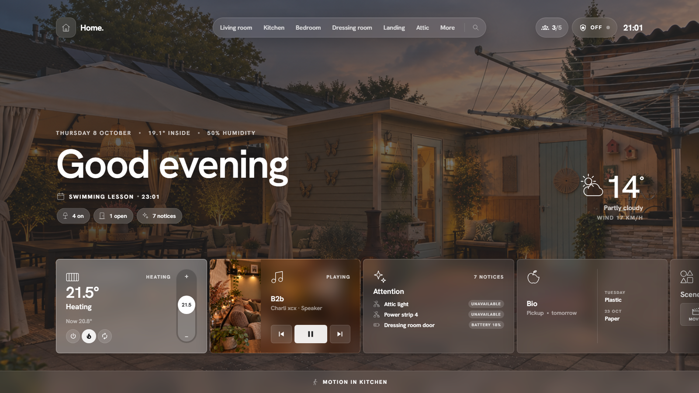
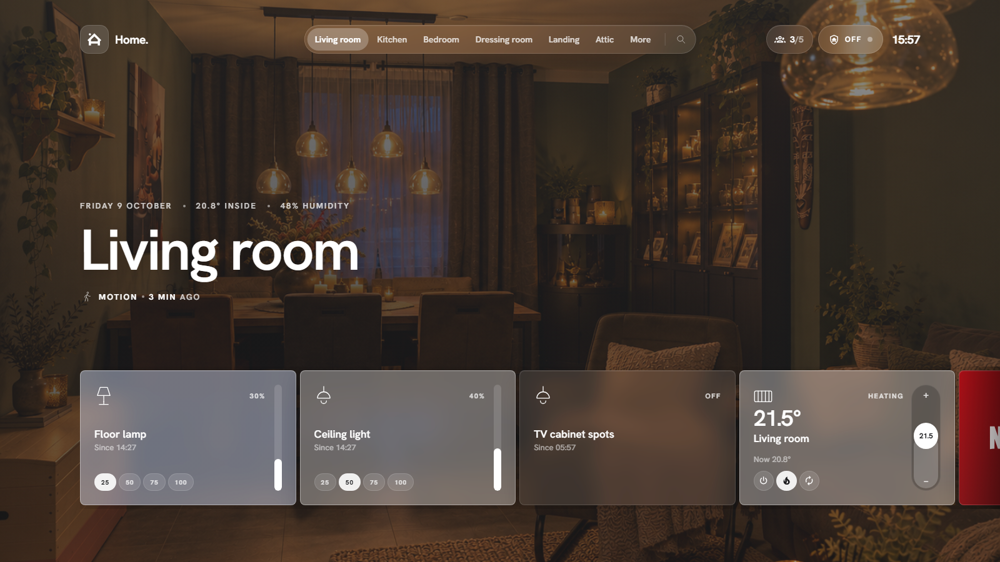

# Home view and rooms

## Navigation

The pill at the top lists your rooms and **More** (the built-in pages and settings). The search icon finds rooms, pages and devices. On the right: who is home, the alarm state and the clock.

On phones and tablets the rooms live in the bar at the bottom: *Home*, the current room (tap it for the list of rooms, or the floors with their rooms when navigation is set to floors), *More* and a search button. The cards become a two-column grid.

- **Swipe** left or right on a room page (outside the cards) for the next or previous room.
- **Scroll** the card strip with the mouse wheel, by dragging, or by touch.
- **Hold a page title** to set up that page.

## Home view

From top to bottom:

- **Date, indoor temperature and humidity.** The average of all rooms, or the sensors you choose under *Settings → Home page*.
- **Greeting.** Changes with the time of day, or set your own per page.
- **Notification line.** Rotates through what is worth knowing: waste pickup, the next appointment, an open door, a playing speaker, a running appliance, active modes, and your own lines (plain text or Jinja templates).
- **Status pills.** Lights on, doors and windows open, items needing attention. Tap one for the list.
- **Quick actions.** Your own buttons: a scene, a script, toggle something, all lights off, media off. Optionally with a confirmation.
- **Weather.** Current conditions with a heads-up when rain is coming; tap for the hourly and 7-day forecast.
- **Cards.** Thermostat, playing media, attention, weather, waste, scenes, agenda, appliances, energy and your groups and template cards.
- **Motion bar.** Shows where motion is detected right now.

## Room pages

Each room shows its photo, its temperature and humidity, a notification line for that room (lights on, open windows, what is playing) and a card for every device in the area. See [Cards](cards.md) for each type.

## Edit mode

Administrators can rearrange a page in place: **More → Edit room** (or *Edit home view*), or hold the page title. The strip then shows every card of the page, including hidden ones:

- **drag** a card by its grip to change the order;
- **×** hides a card; a hidden card stays in the row, dimmed, with an eye to bring it back; a card hidden by its visibility condition shows a gear to its settings instead;
- a **tap** on a card opens its [card settings](card-settings.md);
- **Add card** at the end adds something new (below);
- **Page settings** in the bar at the bottom opens the title, photo and notification-line settings; **Done** leaves edit mode (so does Esc).

On phones the bar at the bottom becomes the edit bar; drag with a short hold.

### Adding a card

**Add card** asks what you want: a **device or entity**, or a new **group**, **graph** or **template card** (those open their settings tab with the room already filled in). For an entity you search by name, id or area; entities without an area come first, entities from other rooms carry their room name, and what is already on this page is greyed out. Then you choose where it belongs:

- **Only in HaCasa** (default): the card is added to this page; nothing changes in Home Assistant. When the entity lives in another room you can hide it there at the same time.
- **Change the area in Home Assistant** (administrators): moves the entity to this area for every dashboard, automation and voice assistant.

The card settings of the new card open right away. A plain sensor (temperature, power, a text) becomes a **value card**: the number large, the name under it, the last change at the bottom, a tap for its details.

## Per-page settings

Open **Page settings** from the edit bar, hold the page title as a non-administrator, or go to **Settings → Pages** to change:

- the **title** and **photo**,
- which **cards** are shown and in which **order**,
- which kinds of **notification lines** appear,
- your **own lines** for that page: plain text, or a Jinja template rendered live by Home Assistant.
