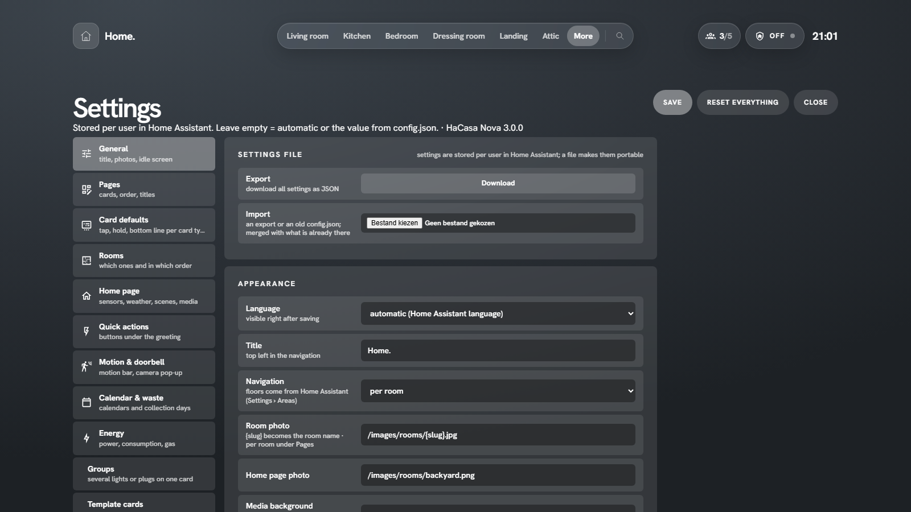

# Settings

Open **More → HaCasa settings**. Changes are a draft until you press **Save**; **Reset everything** clears all settings of the current user. Settings are stored per Home Assistant user.

| tab | what you set there |
|---|---|
| **General** | export and import the settings file, language, title, navigation per room or per floor, photo paths, media background, light scenes on or off, idle screen, battery limit for Attention, run the setup wizard, make the panel Home Assistant's start page |
| **Pages** | per page: title, photo, which cards and in which order (drag or arrows), notification lines, your own lines and the status pills (hide, edit, reorder, add your own, show on a condition) |
| **Card defaults** | a preview per card type (lights, switches, plugs, sensors …); tap it to set tap, hold, the bottom line and what the card shows, with a live preview |
| **Rooms** | which areas are rooms and their order in the navigation |
| **Home page** | temperature and humidity sensors for the header, weather, climate, alarm and the scenes of the scenes card |
| **Quick actions** | the buttons under the greeting: scene, script, toggle, all lights off, media off, with optional confirmation |
| **Motion & doorbell** | which motion sensors drive the motion bar; doorbell triggers and the camera that pops up |
| **Calendar & waste** | calendars for the agenda card and notification line; waste sensors and their labels |
| **Energy** | power, consumption, solar return, gas, the price per kWh, solar power and the home battery |
| **Groups** | cards that combine several lights, switches or plugs |
| **Graphs** | a card with the line of one numeric sensor over the last hours or days |
| **Template cards** | your own cards with Jinja templates |
| **More menu** | your own links next to the built-in pages |
| **Modes** | guest, vacation and other modes linked to an `input_boolean` or switch |
| **Card settings** | every card you changed, with a reset per card |

## Settings file

**General → Settings file → Export** downloads all settings of the current user as JSON. **Import** merges such a file (or a starter `config.json`) into the current settings. Use it to copy a setup to another household member or another Home Assistant.

## Starter config for the card

When you use the [dashboard card](installation.md#2b-dashboard-card), its `config:` block works as a shared starting point for every user. Keys:

| key | meaning |
|---|---|
| `title` | title top left |
| `language` | a language code such as `en`, `nl` or `de`, see [Language](extras.md#language) (leave out to follow Home Assistant) |
| `rooms` | `auto` or a list of area ids or names, in navigation order |
| `roomImage`, `homeImage` | photo paths; `{slug}` is replaced by the room name |
| `home.weather`, `home.climate`, `home.alarm` | entity ids for the home view |
| `home.temperature`, `home.humidity` | sensors for the header (default: average of the rooms) |
| `home.scenes` | list of scene ids |
| `home.waste` | list of `{entity, label}` |
| `home.energy` | `{power, today, returned, gas, solar, solarToday, battery, batteryPower, powerIs}` sensor ids; `powerIs` is `grid` (default) or `house` |
| `cards.todo`, `cards.ev`, `cards.garden` | `{entity}`; `{name, battery, range, power, charging, plug, finish, switch}`; `{zones, next, rain}` (the card settings of those cards) |
| `home.lowBattery` | battery percentage that counts as low (default 20) |
| `more` | extra links: `{label, sub, icon, path}` |

Anything a user sets in the panel wins over the card config.
